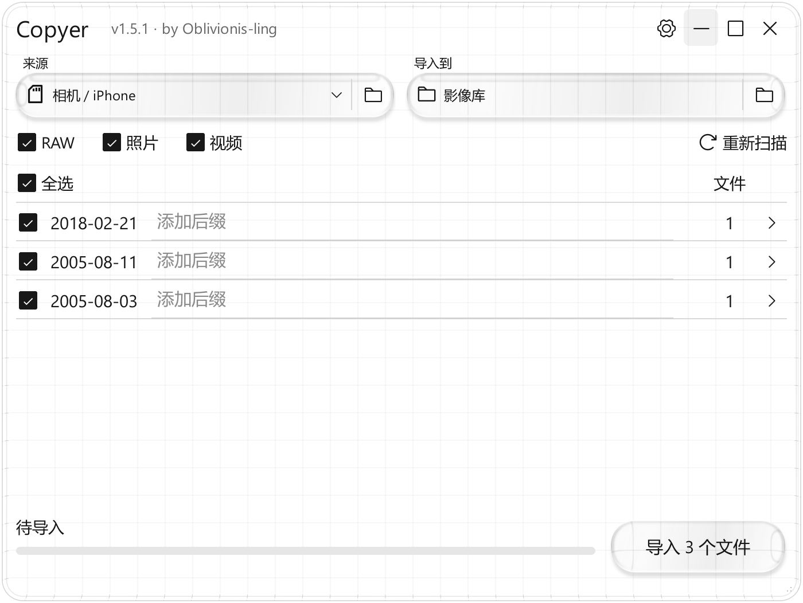

# Copyer

将存储卡里的照片和视频，按拍摄日期导入电脑。Windows 10 / 11，免安装。

[下载便携版](https://github.com/Oblivionis-ling/copyer/releases/latest) · [更新记录](CHANGELOG.md)

1. 完整解压，打开 Copyer。
2. 选择来源和目标，扫描后勾选文件；需要时填写日期后的自定义名称。
3. 点击导入，完成后打开目标文件夹。

- 支持 25 种 RAW、JPEG / HEIF 照片和 MP4 / MOV / M4V 视频，包括佳能 CR3、DJI DNG 和 iPhone 素材。
- 优先读取拍摄日期；没有有效日期时使用修改时间，并在文件明细中标明。
- 只复制，保留原文件；导入后校验内容，同名文件不覆盖。
- 可查看进度、取消导入、继续未完成项或重试失败项。

设置中可查看支持格式、调整视频日期与显示偏好。请保留程序旁的 `_internal` 文件夹。

[格式与日期](docs/FORMATS.md) · [设计档案](docs/design/README.md) · [开发文档](docs/DEVELOPMENT.md) · [第三方许可](THIRD_PARTY.md)

by Oblivionis-ling
