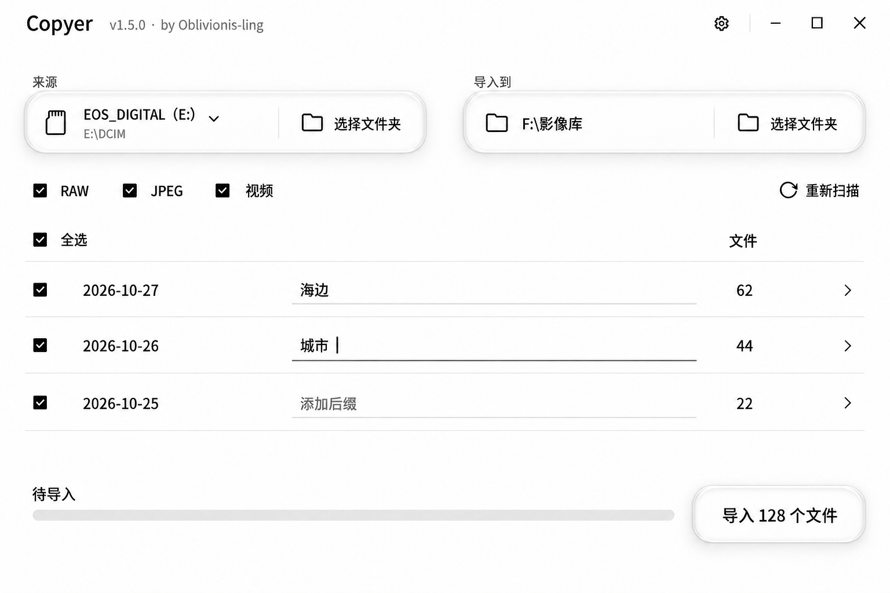

# Copyer v1.5.0 设计与功能评审

评审日期：2026-10-28。代码基线：main / 6da51c0cd6c3ee3beb73747d456729c4089dd922，当前已发布版本 v1.4.0。待导入设计定稿采用用户明确指定的纯白玻璃图，只补“全选”和标题旁的“v1.5.0 · by Oblivionis-ling”。图示版本 v1.5.0 是本轮设计目标；应用源码未改动。

主流程：选择来源与目标 → 选择文件类型 → 确认日期并填写可选后缀 → 导入。

## 1. 原尺寸设计定稿

- **画布**：1536 × 1024 px，按 100% 缩放查看。
- **标题与配色**：主标题 Copyer，右侧小字为“v1.5.0 · by Oblivionis-ling”；沿用指定底图的纯白背景、中性灰轮廓与玻璃光影。
- **复选框**：用户已明确认可暖灰版的尺寸，本轮锁定该尺寸。格式、全选、三组文件全部是同一套小方框；任务中禁用变灰，不换成圆形状态图形。标签点击和命中范围保留。
- **全选**：在现有表头方框右侧显示“全选”；点击方框或文字可切换全部分组的选择，部分选择时使用混合状态。
- **日期与后缀**：日期自动识别、只读；后缀改为文字加细下划线，无矩形边框或填充。空值显示“添加后缀”，获得焦点时下划线加深并出现光标；图中第二行展示焦点状态。
- **按钮**：主动作试用透明玻璃，中心透出背景，边缘有细微折射和轮廓高光，标签为深灰；保留圆角矩形轮廓。设置仍仅为齿轮图标。
- **进度**：保留底部固定轨道与当前阶段；扫描、导入、结果在同一区域显示。
- **范围**：本轮主图为待导入状态，数据为模拟示例。静态图用于评审布局与材质，动态玻璃、真实输入和禁用行为、键盘操作与性能进入实现验收。

生成方式：内置 ImageGen。指定底图、两处文字增补的完整提示词与输出对应关系见[定稿生成记录](Copyer_图像提示词_20261028_定稿.json)。

### 上一轮完整流程参考

以下五图保留暖灰版的完整流程；标题、背景、主按钮和后缀输入的最新视觉以本轮主图为准。

| 状态 | 原尺寸图片 | 关键反馈 |
| --- | --- | --- |
| 待导入 | [查看图片](运行状态/暖灰修订/Copyer_界面_待导入_20261028.png) | 自动日期、可选后缀、分组选择；“导入 128 个文件” |
| 扫描中 | [查看图片](运行状态/暖灰修订/Copyer_界面_扫描中_20261028.png) | 已发现 67 个文件；不确定活动条；选择与输入禁用，可取消 |
| 导入中 | [查看图片](运行状态/暖灰修订/Copyer_界面_导入中_20261028.png) | 68% 字节进度；87 / 128 个文件；当前文件、速度、预计时间与取消 |
| 导入完成 | [查看图片](运行状态/暖灰修订/Copyer_界面_导入完成_20261028.png) | 100% 进度；128 个文件已导入；“打开文件夹” |
| 部分失败 | [查看图片](运行状态/暖灰修订/Copyer_界面_部分失败_20261028.png) | 126 个成功、2 个失败；保留实际进度；查看失败文件、重试失败项 |

流程规则保持：所有状态保留方形选择框、日期列和后缀输入。方框始终表达“是否纳入本次任务”；导入结果由底部文字与进度表达。部分失败在受影响行的文件数旁增加警示图形，不占用选择框。

上一轮的[生成记录](运行状态/暖灰修订/Copyer_图像提示词_20261028.json)保留作迭代对照。

## 2. UI 元素与 Apple 依据

“Apple 描述”为官方指南释义。纯白与中性灰配色、方框大小、下划线输入、透明按钮、圆角和 Windows 窗口按钮位置均为本项目选择，不是 Apple 指定的样式数值。

| 元素 | 功能 | 对应 Apple 描述 | 样式选择的原因 |
| --- | --- | --- | --- |
| 01 Copyer、版本与作者 | 标明产品、目标版本与署名 | [Toolbars][T]：标题简短；[Typography][Y]：通过字阶和层级组织信息 | 保留 Copyer 主标题；按用户要求在同一行补“v1.5.0 · by Oblivionis-ling”，较小的中性灰文字维持主次关系 |
| 02 设置齿轮 | 打开同名处理、格式说明与辅助选项 | [Toolbars][T]：使用易识别符号；[Buttons][B]：清楚区分动作 | 普通图标按钮，默认无底板、无玻璃；悬停与焦点时提供反馈，并有“设置”辅助名称 |
| 03 最小化、最大化、关闭 | 管理窗口 | [Layout][O]：尊重平台习惯；[Accessibility][A]：支持键盘 | 保持 Windows 符号与顺序 |
| 04 来源标签、设备图标、卷名、路径 | 识别读取位置 | [Layout][O]：相关信息分组；[AppKit 新设计][K]：相关操作可共用玻璃面 | 卷名为主、路径为次；以中性透明主体与边缘折射区分控制层 |
| 05 来源下拉箭头 | 切换已识别的设备 | [Pop-up buttons][P]：互斥选择需显示当前值 | 紧邻当前卷名，与手动选目录各有入口 |
| 06 来源“选择文件夹” | 手动指定来源目录 | [Buttons][B]：标签说明动作；[Meet Liquid Glass][G]：避免玻璃嵌套 | 图标文字直接置于来源的共享玻璃面，不再套玻璃按钮 |
| 07 目标标签、图标与路径 | 说明实际写入位置 | [Layout][O]：相关信息就近；[AppKit 新设计][K]：按功能分组 | 与来源配对；保持路径清楚、材质一致 |
| 08 目标“选择文件夹” | 打开目标目录选择器 | [Buttons][B]：动作明确；[Meet Liquid Glass][G]：单层材质层级 | 与来源同样使用玻璃面上的图标文字动作；优先系统目录选择器 |
| 09 RAW、JPEG、视频小方框 | 独立选择导入类别 | [Toggles][C]：复选框适合独立开关；[Accessibility][A]：保留可操作性 | 锁定用户已认可的暖灰版尺寸；方形、深灰底、白勾，标签可点；具体扩展名放设置 |
| 10 重新扫描 | 根据当前来源和格式重建计划 | [Buttons][B]：动作标签清楚，主次可区分 | 轻量图标文字操作；扫描和导入中禁用 |
| 11 “全选”与行小方框 | 选择或取消全部日期组，也可逐组选择 | [Toggles][C]：选中、未选中与混合状态要准确；[Accessibility][A]：控件用途明确 | 表头现有小方框旁增加可见“全选”文字，方框与标签均可点击；沿用已认可尺寸，不另加工具条或第二个按钮 |
| 12 自动日期 | 展示扫描得到的分组日期 | [Lists and tables][L]：属性清楚、便于比较 | 日期单独只读，避免误改导致错分组；不再把日期与后缀合成一个可编辑名称 |
| 13 下划线后缀输入 | 为该日期组填写可选名称 | [Text fields][F]：短文本使用文本输入，用途和编辑状态应可辨认 | 去掉大块填充与矩形边框，保留文字和细底线；空值显示“添加后缀”，焦点底线加深并出现光标；下划线形态是本项目选择 |
| 14 “文件”与每组数量 | 比较分组规模 | [Lists and tables][L]：列标题简短，属性对齐 | 保留有意义的数量列；不在上方重复总文件数和组数 |
| 15 行末箭头 | 查看组内文件和按需预览 | [Lists and tables][L]：层级内容有清楚入口；[Layout][O]：渐进呈现 | 详情按需打开，不常驻照片面板 |
| 16 纯白背景、平面行、细分隔线 | 组织内容，衬出控制层 | [Layout][O]：先用对齐和间距组织；[Materials][M]：内容与控制层区分 | 按用户要求使用纯白底，中性灰线条组织内容；玻璃通过边缘折射和局部灰影表达 |
| 17 “导入 N 个文件”透明按钮 | 开始当前选择的导入计划 | [Buttons][B]：标签明确、动作可识别；[Meet Liquid Glass][G]：折射轮廓表达材质 | 按用户要求试透明主体、细玻璃轮廓和深色文字；通过位置、尺寸与清楚标签辨认主动作，总数仍只在本动作中显示 |
| 18 底部进度条和百分比 | 展示当前阶段的推进 | [Progress indicators][R]：准确进度、固定位置 | 保持线性轨道；总量未知时用活动段，已知时按实际字节填充 |
| 19 阶段、当前文件、数量、速度和剩余时间 | 说明正在处理什么、还需多久 | [Progress indicators][R]：上下文简短、准确；[AppKit 新设计][K]：信息文字不装成玻璃按钮 | 直接放在平面背景上；只显示当前阶段需要的内容 |
| 20 “取消” | 停止当前任务 | [Progress indicators][R]：可行时允许停止；[Buttons][B]：区分主次 | 较轻的浅色次级样式，深灰文字和细轮廓，保持停止入口清楚 |
| 21 “打开文件夹” | 完成后访问本次实际目标 | [Buttons][B]：标签表达明确动作 | 复用任务动作的位置，提供明确结果入口，不增加结果弹窗或历史入口 |
| 22 “重试失败项” | 仅处理失败文件 | [Buttons][B]：突出恢复动作；[Alerts][D]：恢复路径清楚 | 失败时作为唯一主动作，成功文件不重复导入 |
| 23 “查看失败文件” | 查看失败文件和具体原因 | [Layout][O]：细节按需展开 | 普通文字动作，不增加错误大面板 |
| 24 行内警示三角形 | 定位存在失败项的日期组 | [Accessibility][A]：状态不只靠颜色表达 | 放在文件数旁，配合底部失败文字；方形选择框仍保留原义 |

### 材质和配色规格

| 设计项 | 规格及依据 |
| --- | --- |
| 基础配色 | 背景目标 #FFFFFF；文字、线条与阴影采用 R=G=B 的中性灰阶。玻璃中心透出白底，避免蓝、青、紫或米黄色偏色；生成图允许微小像素噪声，实现时使用明确色值 |
| 玻璃范围 | 来源和目标维持 regular 风格；主按钮按本轮要求探索清透主体、细折射边缘和深色标签。[Materials][M] [Meet Liquid Glass][G] |
| 玻璃层级 | 同组路径和选择动作共享表面，内部不叠玻璃；主按钮是独立控制。后缀输入、设置、列表和进度文字维持普通表面。[AppKit 新设计][K] |
| 光照 | 透明控件中心接近白底，材质由细微双轮廓、局部折射、白色高光和短距离中性灰阴影表达；文字清楚，不使用带蓝色的环境光。[Meet Liquid Glass][G] |
| 动态与辅助偏好 | 按压与展开反馈短而明确；减少透明度时用稳定实底，减少动态效果时关闭折射跟随和形变。[Materials][M] [Accessibility][A] |

Apple 的 clear 变体典型用于富媒体背景，regular 更侧重文字可读性。本轮浅色工具界面的透明主按钮是用户指定的视觉探索，需在实现中验证文字对比与按钮辨识；不把它写成 Apple 对此场景的默认推荐。设置仍通过熟悉图标表达功能。

### 全选规则

- “全选”作用于当前扫描结果中符合已选文件类型的全部分组及文件；再点击取消全部选择。
- 全部选中显示勾，全部未选显示空框，部分选中显示横杠；部分选中时点击“全选”补齐所有选择。
- 逐组或逐文件的变化同步更新全选状态和导入按钮数量；选择数为 0 时禁用导入。
- 扫描与导入期间锁定选择，保持本次任务计划一致；标签具有可访问名称，支持键盘焦点与空格切换。

### 日期与后缀规则

- 自动识别的日期只读；分组使用稳定内部 ID，不因后缀编辑改变文件归属。
- 中间输入框仅编辑后缀。日期为 2026-10-27、后缀为“海边”时，输出名称为“2026-10-27-海边”；后缀为空时只使用日期。
- 不额外增加完整目录名列。最终路径在该组详情或输入提示中查看，必要时可复制。
- 拒绝路径分隔符、Windows 非法字符和保留名；最终路径必须位于所选目标目录内。错误在对应输入处说明。[Text fields][F]
- 扫描中后缀不可编辑；准备状态可编辑；导入中及本次结果中保留实际使用的后缀并锁定。重新扫描建立新的可编辑计划。
- 输入框具备稳定的辅助标签；不能仅靠输入后就消失的占位文字表达用途。[Accessibility][A]
- 下划线输入保留正常文本编辑能力；悬停显示文本光标，获得焦点时底线加深，键盘焦点不能只靠细微颜色变化表达。

### 导入进度规则

- 底部位置固定。准备时空轨道；扫描总量未知时用不确定活动段，不展示百分比；总量明确后显示确定进度。[Progress indicators][R]
- 复制按实际字节推进，文件完成数独立显示；大视频复制期间仍有真实反馈。
- 若复制后需要校验，阶段名明确改为“正在校验”；只有必需阶段全部通过，才显示“导入完成”。
- 模拟导入图为 68%、87 / 128 个文件、136 MB/s、约 20 秒；这些不是本机跑分。估计不稳定时显示“估算中”。
- 部分失败示例为 126 个成功、2 个失败，字节进度停在 98%；不因任务结束而补满。成功文件数与完成字节数分别计算。
- 行首小方框始终表示选择；状态不再挤占选择框。任务中禁用参数、后缀和选择，底部提供取消。
- 完成保留 100%，主动作改为“打开文件夹”；失败提供查看原因和重试；取消显示实际结果，不伪装成完成。

### 设置的最小内容

| 设置项 | 内容与表现 |
| --- | --- |
| 同名文件处理 | 默认“自动重命名”；其他策略随确定的功能范围开放。使用互斥选择 |
| 支持格式 · RAW | .cr2、.cr3、.nef、.arw、.raf、.orf、.rw2、.dng |
| 支持格式 · JPEG | .jpg、.jpeg |
| 支持格式 · 视频 | .mp4、.mov、.m4v |
| 格式说明 | 上述为当前 v1.4.0 识别范围，扩展名不区分大小写；只读分组列表，不重复主界面的类型勾选 |
| 辅助选项 | 减少透明度、减少动态效果；优先遵循系统设置 |

格式列表依据 [Lists and tables][L]，策略选择依据 [Pop-up buttons][P]，辅助选项依据 [Accessibility][A]。

### 通用交互规则

- 按钮有悬停、按下、键盘焦点和禁用状态；图标按钮补全提示与辅助名称。[Buttons][B] [Accessibility][A]
- 普通文字以 4.5:1 对比度为目标，支持高 DPI、文字放大与键盘操作；不能把 Apple 的 pt 直接当作 Windows px。[Typography][Y] [Accessibility][A]
- 小方框按视觉缩小，命中范围仍需足够；格式标签与选择框共同响应点击。
- 窄窗口优先把来源和目标纵向排列；日期与后缀的关系保持清楚，不增加侧栏。[Layout][O]

## 3. 按需出现的状态

| 状态／界面 | 必要行为 | 样式与 Apple 依据 |
| --- | --- | --- |
| 未选择／未扫描 | 直接选择目录；无有效计划时禁用导入 | 空进度轨道，不增加常驻解释段落。[Buttons][B] |
| 扫描中 | 显示已发现数量与取消，参数和输入禁用 | 同一轨道使用不确定活动段。[Progress indicators][R] |
| 准备状态 | 选择分组、编辑后缀，日期只读 | 已认可尺寸的小方框与下划线输入；无额外列表标题。[Toggles][C] [Text fields][F] |
| 复制／校验中 | 显示阶段、真实进度与取消；冻结本次计划 | 日期与后缀原位保留，方框不变成圆圈。[Progress indicators][R] |
| 完成／部分失败 | 原位显示结果；打开目标或重试失败项 | 保留任务实际参数；不增加任务历史入口。[Alerts][D] |
| 分组明细 | 按需打开；包含文件属性、最终路径及预览 | 渐进呈现，关闭后返回原组。[Layout][O] |
| 后缀非法 | 说明具体问题并阻止导入，保留输入 | 在对应输入框就地提示。[Text fields][F] |
| 主动清理源文件 | 仅在完成后明确发起；复核源与目标并确认范围 | 清理资格与可靠性要求见第 5 节，主界面不放规则段落。[Alerts][D] |
| 设置 | 同名处理、具体格式与辅助选项 | 紧凑分组，不增加常驻导航。[Layout][O] |

## 4. 现有功能覆盖

| 领域 | v1.4.0 已实现 | 当前边界 |
| --- | --- | --- |
| 来源识别 | Windows 可移动盘枚举；默认取首个；手动目录选择 | 固定盘型读卡器需手选；没有多卡列表、热插拔监测 |
| 格式扫描 | 递归目录；8 种 RAW 扩展名、JPEG、MP4/MOV/M4V；扩展名不区分大小写 | 类型靠扩展名；扫描在 UI 线程；没有逐文件错误汇总 |
| 日期归类 | JPEG 读取 EXIF；否则使用修改日期；按天排序 | RAW／视频只使用修改时间；日期来源不可见；无时区规则 |
| 导入计划 | 日期分组、数量、后缀、生成目录预览 | 无逐组／逐文件排除；日期单元格误可编辑；没有容量与完整文件明细 |
| 文件复制 | 后台线程；`copy2` 保留基础文件元数据；同名文件自动编号 | 无内容去重、校验、临时文件提交或失败项恢复 |
| 进度与结果 | 按完成文件数更新进度；每文件日志；成功或失败提示 | 大文件期间进度不动；无字节进度、速度、取消、部分成功报告 |
| 目标访问 | 输入／创建目标目录；打开目标文件夹 | 缺少空路径、源目标关系、写入权限及空间预检 |
| 源文件清理 | 对当前会话记录的源路径二次确认后删除，汇总成功／跳过／失败数 | 不复核副本；不核对源文件是否已变；失败任务可能沿用旧清理记录 |
| 偏好与窗口 | 保存路径和格式；中文字体与 Qt 翻译；无边框主窗、对话框和目录选择器 | 无统一任务状态；没有导入中关闭保护；原生窗口能力需重新验收 |
| 测试与构建 | 10 项 unittest；项目 Conda 环境；PyInstaller onedir；隔离构建 PATH | 测试主要覆盖正常路径和旧 UI 外观；未见自动 CI、依赖锁定或集成故障测试；版本号散落于文件名和文档 |

## 5. 应优先修复的问题

**P0：可能丢数据、写错位置或执行错任务。P1：影响可靠性、响应与反馈。** “已复现”均使用项目临时目录里的合成文件；未触碰个人照片。

| 优先级 | 问题与实际触发 | 建议修复／验收结果 | 证据 |
| --- | --- | --- | --- |
| P0 | **源文件清理不验证副本。** 删除目标副本后，程序仍允许删源；源文件复制后变化，也仍会被删 | 记录源→目标映射和文件指纹；删除前重新确认目标完整、源身份未变；不满足条件则拒绝清理 | 已复现两种情况；[清理逻辑][S995] |
| P0 | **空路径落到当前工作目录。** 清空来源会扫描当前目录；清空目标会向当前目录导入 | 在构造 `Path` 前拒绝空白；检查实际目录、可写性；目标路径必须明确展示 | 已复现；[扫描][S835]、[导入][S912] |
| P0 | **后缀可写出目标目录。** `x/../../escaped-target` 使生成目录越过用户选定的目标 | 后缀仅作单段目录名；拒绝分隔符、保留名、非法字符；解析后的最终路径必须位于目标内部 | 已复现；[命名][S132]、[复制][S165] |
| P0 | **扫描结果过期。** 换卡／换来源或取消 JPEG 选择后，导入计划仍保留旧 JPEG | 来源、格式变化即令计划失效；以不可变快照绑定来源与参数；执行前复核源身份 | 已复现；[偏好连接][S787]、[计划][S898] |
| P0 | **中断留下残缺成品。** 模拟第二个文件断开复制后，目标保留半文件；成功的第一个文件也不随失败结果返回 | 写入临时名，校验通过后提交正式名；逐文件记录成功／失败；重试不重复已完成项；冲突分配也需防并发覆盖 | 已复现中断与结果丢失；[复制][S165] |
| P0 | **失败任务沿用旧清理列表。** 新任务失败后，上一次的源路径记录仍存在 | 任务结果、清理资格绑定任务 ID；开始新任务时切换上下文，不能把旧记录当成本次结果 | 已复现失败处理保留旧列表；[成功／失败处理][S964] |
| P1 | **目标可位于来源内部。** 再扫描会把刚导入的副本作为新源文件 | 规范化路径，阻止来源等于目标或目标位于来源树内；处理链接／junction；明确允许的外部目标 | 已复现下一次扫描收进副本；[扫描][S138]、[导入][S912] |
| P1 | **扫描会占住界面，单文件异常可中断回调。** `_scan_files` 同步遍历并读 EXIF，没有逐文件隔离 | 后台扫描、可取消、分批进度、逐文件失败列表；一张坏照片不阻止其他照片 | 同步调用为代码确认；异常传播已复现；[扫描入口][S835] |
| P1 | **任务参数在复制中仍可编辑。** 四个动作按钮被禁用，来源、目标、格式和后缀仍可改 | 冻结本次参数或明确分离“当前任务”与“下次设置”；任务结束打开实际写入目标 | 已复现输入仍启用；[禁用逻辑][S980] |
| P1 | **日期单元格可编辑导致文件漏入计划。** 修改日期后，代码用新日期查旧字典，得到空列表 | 日期与统计只读；用稳定分组 ID；如要改日期，提供真正重分组操作 | 已复现该组变为 0 文件；[表格][S864]、[计划][S898] |
| P1 | **EXIF 回退提前停止。** `DateTimeOriginal` 非法、`DateTime` 有效时仍退回修改时间 | 每个候选字段分别解析；单字段失败继续尝试；展示最终采用的日期来源 | 已复现；[EXIF][S89] |
| P1 | **缺少安全取消与关闭保护。** 复制线程没有取消协议，窗口没有任务进行中的关闭处理 | 文件分块复制、取消点与临时文件清理；关闭时等待安全停止；未完成项目可恢复或重试 | 代码确认，未模拟强制关闭；[线程启动][S912] |
| P1 | **没有容量／权限预检、字节进度与完整结果。** 任务开始后才可能发现空间不足；大视频长时间不更新 | 预估需写入体积与目标可用空间；任务中继续处理容量变化；分复制／校验阶段报告进度，提供错误原因和重试项 | 代码确认；[复制][S165]、[进度][S958] |

源文件清理若暂时无法做到上述复核，建议 v1.5.0 先移除这个入口，保留“打开目标文件夹”。比继续提供不可靠的删除能力更符合照片导入工具的目的。

## 6. 可继续丰富的功能

| 优先顺序 | 功能 | 最小有用范围 | 边界／代价 |
| --- | --- | --- | --- |
| 1 | **逐组／逐文件选择** | 日期组全选、部分选、文件明细；导入数量实时一致 | 主界面已有位置；与安全修复一起做 |
| 2 | **重复内容识别** | 同名文件先比较大小，再按需哈希；同内容可跳过，同名不同内容重命名 | 不能只靠名字或大小判断相同；不默认全盘哈希 |
| 3 | **RAW／视频拍摄时间** | 支持实际使用的相机格式；优先可靠元数据，保留修改时间回退及来源说明 | 元数据工具与时区规则需要单独验证；不承诺一次兼容所有格式 |
| 4 | **本次结果与失败项重试** | 展示本次成功／跳过／失败结果；打开实际目标；只重试失败项 | 不增加任务历史入口；恢复任务所需的内部数据不占主界面 |
| 5 | **缩略图与快速预览** | 首批做 JPEG；RAW 用可用内嵌预览；视频取封面 | 异步、按需加载、有限缓存；不建设图库编辑器 |
| 6 | **多设备与热插拔** | 卷名、盘符、容量、设备候选列表；掉盘后暂停并解释 | 设备身份不能仅靠盘符；固定盘模式读卡器须手动确认来源 |
| 7 | **命名预设与配对文件** | 按日／年月日目录；后缀模板；RAW+JPEG 与 XMP sidecar 保持配对 | 先提供少量预设，不做复杂规则语言 |
| 8 | **明确取消与重试** | 停止当前任务，保留已完成结果；重新开始时跳过已验证完成项 | 真正断点续传可后置；首版不必同时做暂停、排队和多任务 |
| 9 | **伴随文件与格式扩展** | 根据实拍设备补 HEIC/HIF、TIFF、PNG、XMP、SRT 等 | 先区分照片、视频、伴随文件；不把“扩展名支持”等同于“元数据支持” |
| 10 | **双目标备份** | 主目录与备份目录都校验通过后才给出清理资格 | 增加磁盘 I/O、状态与失败组合；建议后续版本 |
| 11 | **完成提醒与设备弹出** | 任务结果通知；明确用户触发的安全弹出 | 只在复制和校验完全停止后允许；不默认自动清卡 |
| 12 | **发布质量** | 版本信息统一、变更记录、依赖锁定、自动测试、打包后启动检查 | 优先可靠便携包；自动升级、签名安装器可按分发需求再做 |

暂不加入云同步、账号体系、AI 分类、人脸识别、照片编辑和大型资源库管理。这些会明显扩大权限、依赖与维护范围，对“把卡里的媒体可靠导入到正确目录”收益有限。

## 7. 建议的 v1.5.0 范围

1. 完成上述 P0，以及扫描后台化、异常隔离、只读日期、任务取消与关闭保护。
2. 替换主窗、输入、表格、提示和预览的视觉系统；使用系统目录选择器。
3. 加入分组选择、按需展开的文件明细、容量预检、字节进度和校验结果。
4. 提供本次导入结果、失败项重试与基础重复识别，不增加任务历史入口。
5. 将 JPEG 预览收进文件明细；提供减少透明度、键盘操作和高 DPI 适配。

RAW／视频元数据支持可作为紧随其后的增量；若实拍主要依赖 RAW 或视频，应将它提前到第 3 项。双目标备份和高级命名延后。

**验收底线**：不覆盖已有不同内容文件；失败不留下冒充完整文件的成品；输入变化不执行旧计划；清理不会删除未验证的源文件；坏文件、断连和取消都有明确结果；所有任务在较大文件与高 DPI 环境下可操作。

## 8. 验证记录

- 现有测试：同一代码基线的 10 项 unittest 全部通过，覆盖基础扫描／复制及旧界面约束。
- 初次功能评审另做 14 个合成场景检查，结果如下。它们用于识别缺口，不表示新功能已经实现；本轮图片修订未重跑这些场景。
- 所有样本与模拟失败发生在项目 `_work` 下；未对真实存储卡、个人媒体或用户设置进行写入。

| 场景 | 观察结果 |
| --- | --- |
| 来源为空 | 扫描到当前工作目录的样本文件 |
| 目标为空 | 文件写入当前工作目录的日期子目录 |
| 换来源并取消 JPEG | 导入计划仍包含旧来源的 JPEG |
| 修改表格日期 | 对应计划中的文件数变为 0 |
| 后缀含目录跳转 | 文件写出所选目标目录，但仍限制在临时样本区内 |
| 第二个文件复制中断 | 第一个完整文件和第二个半文件留在目标；无成功清单信号 |
| 删除目标后清理源 | 源仍被删除 |
| 复制后修改源再清理 | 变化后的源仍被删除 |
| 主 EXIF 日期坏、备用日期好 | 使用修改日期，未使用有效备用 EXIF |
| 单文件日期读取抛异常 | 异常传播出扫描回调 |
| 相同文件重复导入 | 生成 `a.jpg` 与 `a_1.jpg`，没有内容去重 |
| 目标位于来源内 | 再扫描同时包含原文件和导入副本 |
| 复制中禁用动作按钮 | 来源、目标和格式控件仍启用 |
| 新任务失败 | 旧任务的源文件清理列表仍保留 |

图像核验：定稿为 1536 × 1024。已对照用户指定底图检查三处玻璃的双轮廓、局部灰影、纯白背景和小方框尺度；确认新增“全选”标签，以及“v1.5.0 · by Oblivionis-ling”的版本和昵称拼写。日期、下划线后缀输入、焦点光标、空进度轨道与 62 + 44 + 22 = 128 的数量关系保持。前轮五图继续作为流程参考；动态材质、真实选择和输入行为、键盘焦点、对比度及性能进入实现验收。

减法审查：“全选”补足既有控件的用途，版本与作者满足产品标识需求。两处信息均放入现有空位，没有新增控件容器、工具条、说明段落或装饰；其余结构与材质保持定稿底图。

本轮交付待导入设计定稿、提示词记录及交互说明；前轮完整流程图保留，后续实现以定稿的视觉与本文的状态规则为准。应用源码保持原样。

## 官方参考

以下页面于 2026-10-28 读取官方正文；引用描述采用释义，具体设计值另行标明。

- [Meet Liquid Glass，WWDC25][G]：透镜折射、动态高光、背景适应、层级及形变。
- [Build an AppKit app with the new design，WWDC25][K]：功能分组与玻璃面，避免把信息文字做成玻璃按钮。
- [官方材质参考图](https://devimages-cdn.apple.com/wwdc-services/images/3055294D-836B-4513-B7B0-0BC5666246B0/9910/9910_wide_900x506_2x.jpg)：来自 Meet Liquid Glass 会话页，用于前轮材质研究；本轮以上版待导入图为编辑底图。本地参考保存于 `references/Apple_LiquidGlass_WWDC25_参考.jpg`，不作为 Copyer 运行资产。

- [Materials][M]：控制层／内容层、regular／clear、透明度与对比。
- [Toolbars][T]：标题、操作分组、主操作、同心圆角。
- [Buttons][B]：视觉主次、动作标签、状态与角色。
- [Lists and tables][L]：列标题、选择反馈、可读性。
- [Text fields][F]：用途提示、输入长度、就地校验。
- [Toggles][C]：独立复选、状态与混合选中。
- [Pop-up buttons][P]：互斥策略和默认值。
- [Progress indicators][R]：真实进度、固定位置、停止处理。
- [Alerts][D]：减少打断、清晰动作与取消入口。
- [Accessibility][A]：对比、键盘、字号、减少动态效果。
- [Typography][Y]：可读性与字体层级。
- [Layout][O]：分组、渐进呈现、平台与尺寸适配。

[M]: https://developer.apple.com/design/human-interface-guidelines/materials
[T]: https://developer.apple.com/design/human-interface-guidelines/toolbars
[B]: https://developer.apple.com/design/human-interface-guidelines/buttons
[L]: https://developer.apple.com/design/human-interface-guidelines/lists-and-tables
[F]: https://developer.apple.com/design/human-interface-guidelines/text-fields
[C]: https://developer.apple.com/design/human-interface-guidelines/toggles
[P]: https://developer.apple.com/design/human-interface-guidelines/pop-up-buttons
[R]: https://developer.apple.com/design/human-interface-guidelines/progress-indicators
[D]: https://developer.apple.com/design/human-interface-guidelines/alerts
[A]: https://developer.apple.com/design/human-interface-guidelines/accessibility
[Y]: https://developer.apple.com/design/human-interface-guidelines/typography
[O]: https://developer.apple.com/design/human-interface-guidelines/layout
[G]: https://developer.apple.com/videos/play/wwdc2025/219/
[K]: https://developer.apple.com/videos/play/wwdc2025/310/
[S89]: https://github.com/Oblivionis-ling/copyer/blob/6da51c0cd6c3ee3beb73747d456729c4089dd922/copyer.py#L89
[S132]: https://github.com/Oblivionis-ling/copyer/blob/6da51c0cd6c3ee3beb73747d456729c4089dd922/copyer.py#L132
[S138]: https://github.com/Oblivionis-ling/copyer/blob/6da51c0cd6c3ee3beb73747d456729c4089dd922/copyer.py#L138
[S165]: https://github.com/Oblivionis-ling/copyer/blob/6da51c0cd6c3ee3beb73747d456729c4089dd922/copyer.py#L165
[S787]: https://github.com/Oblivionis-ling/copyer/blob/6da51c0cd6c3ee3beb73747d456729c4089dd922/copyer.py#L787
[S835]: https://github.com/Oblivionis-ling/copyer/blob/6da51c0cd6c3ee3beb73747d456729c4089dd922/copyer.py#L835
[S864]: https://github.com/Oblivionis-ling/copyer/blob/6da51c0cd6c3ee3beb73747d456729c4089dd922/copyer.py#L864
[S898]: https://github.com/Oblivionis-ling/copyer/blob/6da51c0cd6c3ee3beb73747d456729c4089dd922/copyer.py#L898
[S912]: https://github.com/Oblivionis-ling/copyer/blob/6da51c0cd6c3ee3beb73747d456729c4089dd922/copyer.py#L912
[S958]: https://github.com/Oblivionis-ling/copyer/blob/6da51c0cd6c3ee3beb73747d456729c4089dd922/copyer.py#L958
[S964]: https://github.com/Oblivionis-ling/copyer/blob/6da51c0cd6c3ee3beb73747d456729c4089dd922/copyer.py#L964
[S980]: https://github.com/Oblivionis-ling/copyer/blob/6da51c0cd6c3ee3beb73747d456729c4089dd922/copyer.py#L980
[S995]: https://github.com/Oblivionis-ling/copyer/blob/6da51c0cd6c3ee3beb73747d456729c4089dd922/copyer.py#L995
